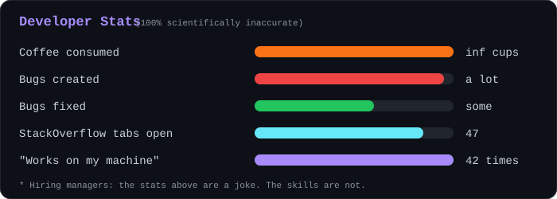
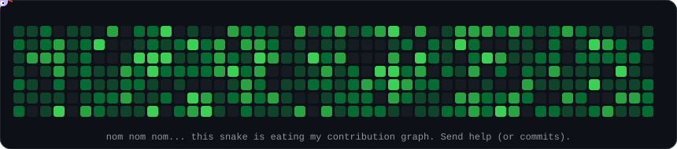

<div align="center">


<br/>


</div>

## 🧠 `whoami`

```python
class Cangu:
    role   = "Business Data Analytics student"
    based  = "Vietnam"
    fuel   = ["coffee", "deadlines", "Ctrl+Z"]
    skills = ["Python", "SQL", "EDA", "Machine Learning", "Dashboards"]

    def solve(self, problem):
        try:
            return self.google(problem) or self.stackoverflow(problem)
        except Exception:
            return "restart the kernel and pretend nothing happened"

    def goal(self):
        return "land an internship before my laptop fan quits"
```

> 💬 Ask me about **Python, SQL, EDA, ML**... or why my notebook worked yesterday but not today.

## 🛠️ Stuff I Google daily

<div align="center">


</div>

## 📌 Projects I'm (mostly) proud of

| Project | What it does | Honest description |
|---|---|---|
| [**Adult-Income**](https://github.com/xtames910/Adult-Income) | Predicts whether someone earns over $50K | Guessing who's rich. Spoiler: not me. Yet. |
| [**finenet**](https://github.com/xtames910/finenet) | Stock price analysis & forecasting | Predicts the market so I can ignore it and buy high anyway |
| [**sql-training**](https://github.com/xtames910/sql-training) | SQL practice | `SELECT * FROM my_skills WHERE bugs = 0;` → 0 rows returned |
| **Customer Segmentation** | K-means clustering | Marie Kondo, but for shoppers |
| **Shopping Trends Analysis** | Customer behavior EDA | Finding out why people click "Add to cart" at 2 AM |

## 📊 Stats

<div align="center">
  
</div>

## 🐍 My contribution graph (being eaten)

<div align="center">
  
</div>

## 📫 Hire me. Please.

<div align="center">

[-0A66C2?style=for-the-badge&logo=linkedin&logoColor=white)](https://www.linkedin.com/in/lan-phuong-5b0a08392/)
[](https://github.com/xtames910)
[](mailto:phuongbtl0910@gmail.com)

<br/>

*"In God we trust. All others must bring data."*

*Correlation does not imply causation, but it does imply I need an internship.*

</div>
